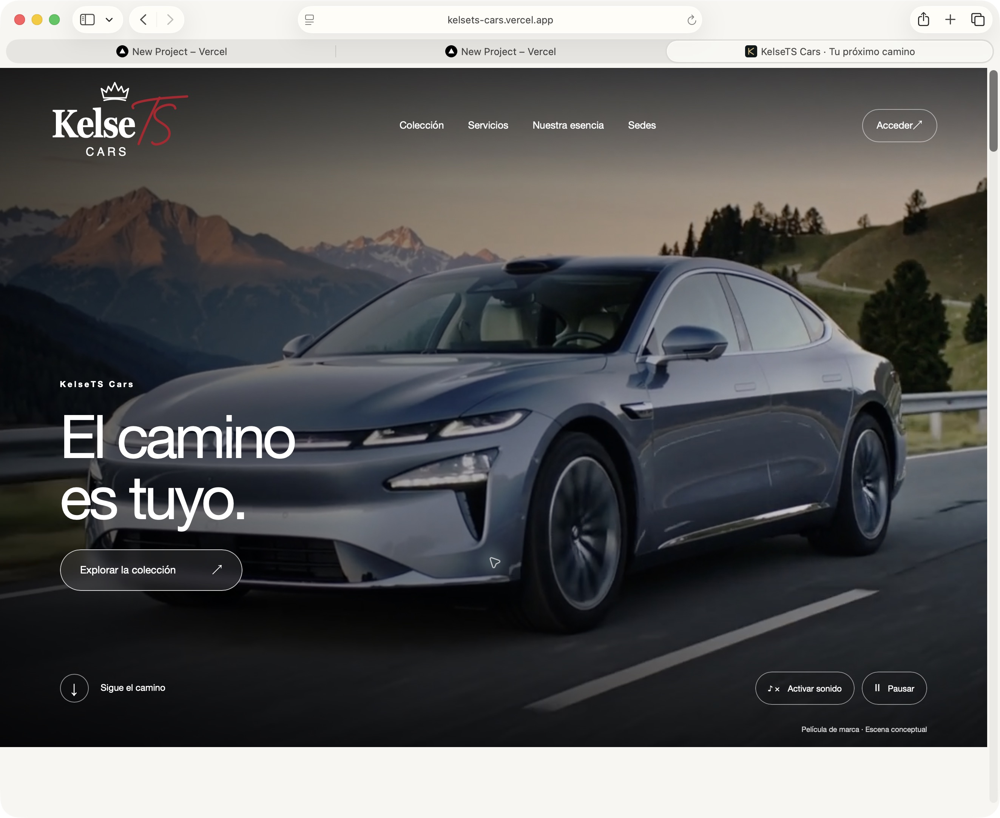
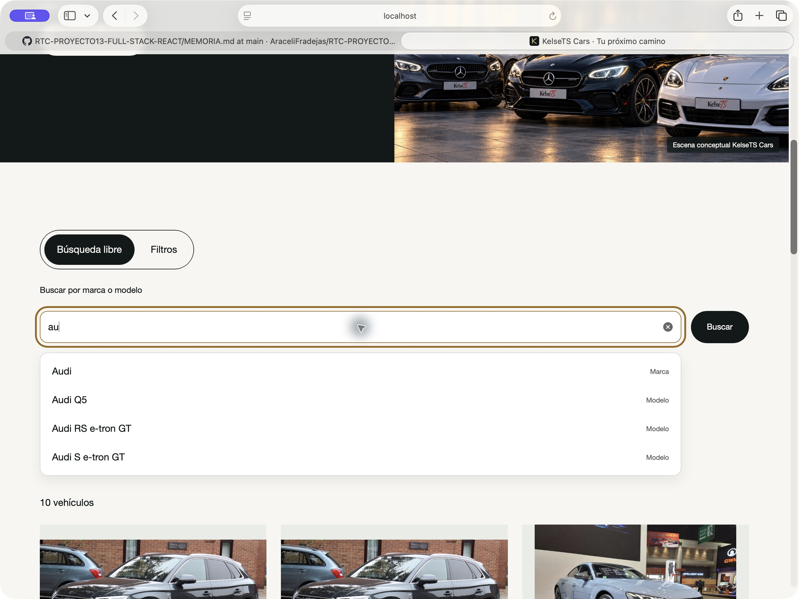
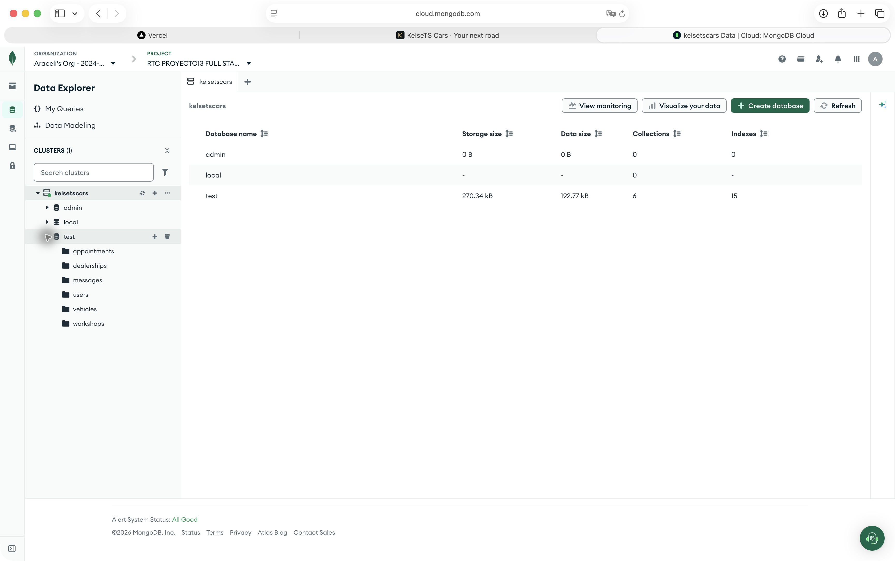
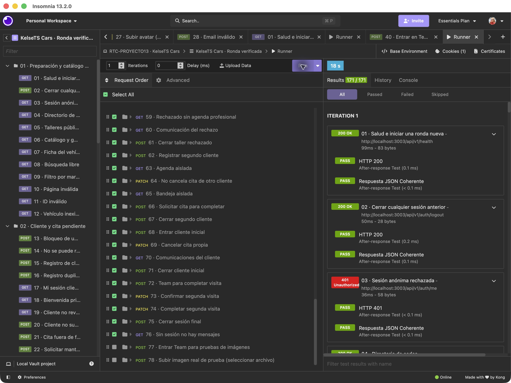
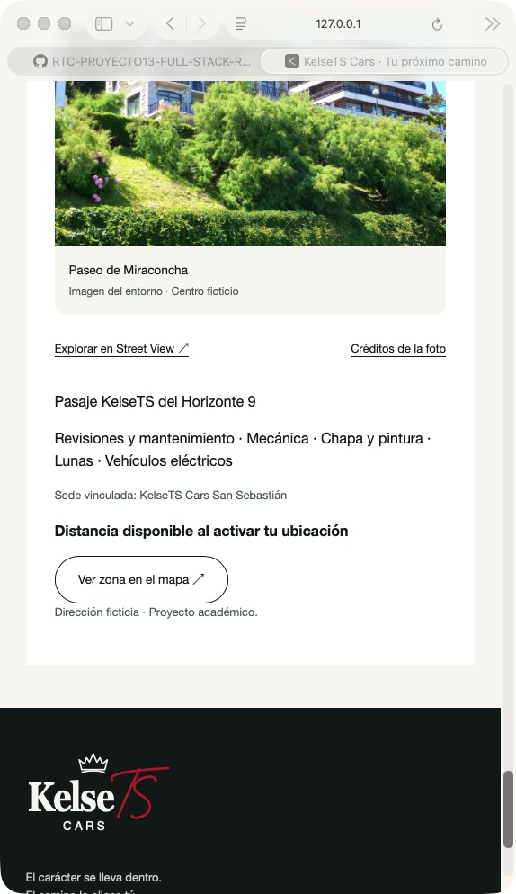
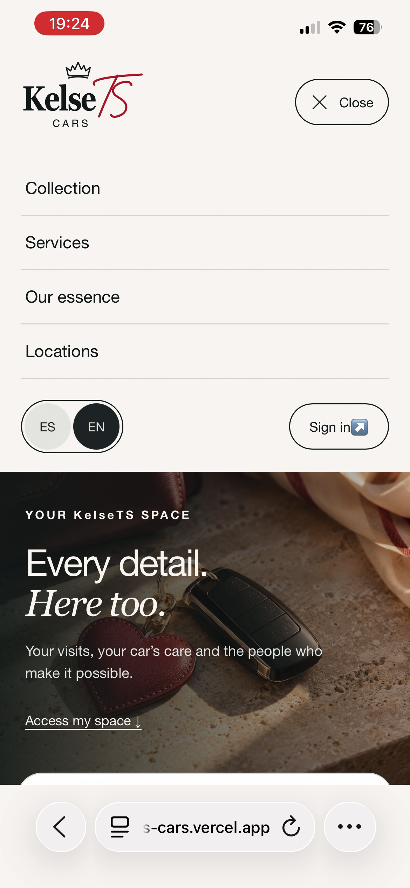

# KelseTS Cars

[Versión en castellano](#versión-en-castellano) · [English version](#english-version)

## Versión en castellano

Proyecto full stack del máster **Rock The Code · The Power Tech School**.

> **El carácter se lleva dentro. El camino lo eliges tú.**

KelseTS Cars es una red ficticia de concesionarios de vehículos de lujo. En la web puedes consultar el catálogo, conocer nuestras cuatro sedes y solicitar una cita para una prueba de conducción, asesoramiento o mantenimiento.

**Web:** [Abrir KelseTS Cars](https://kelsets-cars.vercel.app). **Backend:** [Comprobar la API](https://kelsets-cars-api.vercel.app/api/v1/health).

### Una historia personal

KelseTS Cars continúa la marca ficticia con la que he dado identidad a KelseTS Lifestyle, KelseTS Store, KelseTS Business School y KelseTS Talks. La música, el deporte y el universo swiftie siguen siendo parte de la inspiración, esta vez llevados a una web dedicada a los coches de lujo.

Para mi último trabajo de Rock The Code quería una propuesta que me ilusionara y que tuviera una utilidad clara. Me he imaginado a una persona que busca su próximo coche: necesita comparar modelos, saber dónde puede verlos y organizar una visita sin perderse entre páginas. A partir de ese recorrido he construido el catálogo, las sedes y las citas.

La experiencia continúa cuando el vehículo necesita cuidado. Por eso he incorporado talleres colaboradores y un equipo que coordina sus citas con los clientes. El diseño mantiene la identidad de KelseTS y cada perfil tiene su propia área, pero todos forman parte de la misma web.

### Qué puedes hacer en la web

- Conocer la marca desde una portada con vídeo, controles de sonido y pausa.
- Consultar 148 vehículos, buscar por marca o modelo con sugerencias y utilizar filtros.
- Abrir la ficha de una unidad y solicitar una cita en su sede.
- Consultar cuatro concesionarios y cuatro talleres en el mapa, calcular distancias y conocer sus barrios con fotografías y enlaces a Street View.
- Registrarte como cliente o solicitar el alta de un taller colaborador.
- Consultar las citas y comunicaciones de tu cuenta. Team revisa solicitudes, coordina visitas y asigna mantenimientos; cada taller consulta sus trabajos.
- Subir y sustituir fotografías del catálogo desde una cuenta administradora.
- Cambiar entre castellano e inglés sin perder la pantalla ni la sesión.

El inventario, las sedes y los talleres se cargan desde los CSV en MongoDB Atlas. Repetir la semilla conserva los registros existentes y no duplica el catálogo. Las personas, direcciones y operaciones del proyecto son ejemplos de demostración.

### Estructura y tecnologías

He organizado el código por funcionalidades para que resulte fácil localizar cada parte. Las páginas coordinan la carga de datos y la navegación; los filtros, tarjetas, formularios y filas de citas tienen componentes propios. Las validaciones y las peticiones HTTP se comparten entre la web y el backend.

```text
backend/src/
  modules/          # Usuarios, catálogo, citas, talleres y comunicaciones
  config/           # Entorno y conexión a MongoDB
  middlewares/      # Sesión, permisos y origen de las peticiones
  routes/           # Rutas de la API
  seeds/            # Lectura, validación y carga de CSV
  utils/            # Errores y reglas comunes
frontend/src/
  app/              # Rutas de la web
  features/         # Marca, catálogo, acceso y citas
  shared/           # Componentes, hooks, idiomas y conexión HTTP
  styles/           # Variables y estilos por funcionalidad
packages/
  contracts/        # Validaciones compartidas
  api-client/       # Cliente HTTP reutilizable
data/
  excel/            # Libro de origen
  csv/              # Datos que lee la semilla
  media/            # Fuentes y créditos de fotografías
docs/               # Memoria técnica, guías y evidencias
```

**Frontend:** React, React Router, Vite, Leaflet y CSS. **Backend:** Node.js, Express, Mongoose, JWT, bcrypt, Zod, Multer y Cloudinary. **Datos:** MongoDB Atlas y lectura de CSV con `node:fs/promises`. **Pruebas:** `node:test`, Supertest y Vitest.

`useResource` utiliza `useReducer` para los estados de carga, error y resultado, cancela peticiones con `AbortController` y permite reintentarlas. Los contextos comparten la sesión y el idioma; el mapa reúne su lógica de ubicación en un hook. Los colores y espaciados se definen en `style.css`.

### Instalación local

1. Clona el repositorio y entra en la carpeta:

   ```bash
   git clone https://github.com/AraceliFradejas/RTC-PROYECTO13-FULL-STACK-REACT.git
   cd RTC-PROYECTO13-FULL-STACK-REACT
   ```

2. Con Node.js 22 o posterior, instala las dependencias y prepara las variables:

   ```bash
   npm install
   cp backend/.env.example backend/.env
   cp frontend/.env.example frontend/.env
   ```

3. Configura `MONGODB_URI` y un `JWT_SECRET` de al menos 32 caracteres en `backend/.env`. Los ejemplos explican las demás variables, incluidas las de Cloudinary. Los archivos `.env` y `DocBase/` están excluidos de Git.

4. Comprueba los datos, carga la semilla en tu base y arranca:

   ```bash
   npm run data:check
   npm run seed:check
   npm run seed
   npm run dev
   ```

La web abre en `http://localhost:5173` y la API en `http://localhost:3000/api/v1`. Para ejecutar las pruebas utiliza `npm test`; para compilar, `npm run build`.

### Datos y fotografías

El [Excel de datos](data/excel/KelseTS-datos.xlsx) tiene cuatro hojas: una guía y las tres colecciones iniciales de vehículos, sedes y talleres. He conservado los 100 vehículos del curso y añadido 48 registros de demostración de doce modelos de gama alta, repartidos entre las cuatro sedes.

El proceso es **Excel → CSV → lectura con `fs` → MongoDB**. `npm run data:export` exporta las hojas de datos y `npm run data:check` compara el libro con los CSV. La semilla utiliza claves estables para evitar duplicados y conserva las fotografías de los vehículos ya guardados. La [guía de datos](docs/DATOS-EXCEL.md) explica sus reglas.

Los modelos añadidos se han contrastado con fuentes oficiales; el inventario y las operaciones son ficticios. Los datos comerciales del curso son ejemplos y los campos sin verificar de la ampliación quedan vacíos. Las fotografías del catálogo son referencias identificadas como tales, con autores y licencias en [Recursos](docs/RECURSOS.md) y la [galería](docs/GALERIA-VEHICULOS.md).

Las escenas de marca son creaciones para el proyecto. El vídeo de portada forma parte de los recursos de KelseTS Cars y su música está creada con Suno. Los créditos recogen las herramientas y fuentes utilizadas.

### Usuarios DEMO para validar la entrega

He preparado cuatro accesos DEMO de solo lectura en la [web publicada](https://kelsets-cars.vercel.app/acceso). La contraseña común es **`KelseTS-Demo-2026!`** y pertenece únicamente a estos ejemplos públicos. En el formulario, selecciona el acceso de la primera columna e inicia sesión con su correo.

| Acceso | Correo | Qué puedes revisar |
| --- | --- | --- |
| Soy cliente · Cliente DEMO | `cliente.demo@kelsets.example` | Dos citas de ejemplo: una completada y otra cancelada, y sus comunicaciones. |
| Soy un taller · Taller DEMO aprobado | `taller.demo@kelsets.example` | Perfil aprobado, una cita de mantenimiento asignada y su bandeja de mensajes. |
| Soy un taller · Taller DEMO no aprobado | `taller.rechazado.demo@kelsets.example` | Solicitud no aprobada, motivo y comunicaciones; no tiene acceso a trabajos. |
| KelseTS Cars Team · Team DEMO | `team.demo@kelsets.example` | Agenda y solicitudes de los perfiles DEMO, con sus relaciones entre cliente, taller y sede. |

Estos ejemplos reproducen el recorrido de mantenimiento y las solicitudes de talleres que he utilizado en las pruebas. Son cuentas y operaciones ficticias, separadas de las cuentas originales. Los talleres DEMO no aparecen en el directorio público.

Puedes cambiar entre castellano e inglés, consultar cada área privada y cerrar sesión antes de entrar con otro perfil. Las cuentas muestran un aviso DEMO y no permiten solicitar, cancelar o modificar citas, revisar solicitudes ni subir fotografías. El backend también bloquea las escrituras; Team DEMO solo consulta datos de otros perfiles DEMO. Las cuentas normales conservan sus permisos.

Para comprobar un registro nuevo puedes utilizar un correo ficticio y una contraseña propia. Las pruebas de modificación y los casos negativos están documentados en [Insomnia](docs/INSOMNIA.md); sus 76 peticiones se ejecutan en una base temporal independiente.

### Comunicaciones y fotografías

He adaptado el planteamiento de [KelseTS Talks](https://github.com/AraceliFradejas/RTC-PROYECTO10-FULL-STACK-JAVASCRIPT), otro proyecto de mi portfolio. Cada alta o cambio de cita genera un mensaje dirigido a la cuenta que corresponde. La bandeja privada muestra el contenido en el idioma elegido y conserva el historial.

También he preparado diez muestras HTML y texto recibidas en Mailtrap Sandbox. Todas mantienen el logo de la web y un footer común editable, con una imagen exclusiva según el contenido. El Sandbox permite revisar esas muestras sin enviar mensajes a buzones personales. Los eventos de la aplicación guardan comunicaciones simuladas en la cuenta; este proceso es independiente de las muestras de Mailtrap.

Una administradora gestiona las fotografías desde la ficha del vehículo: selecciona JPEG, PNG o WebP de hasta 4 MB, revisa la vista previa y guarda. React envía el archivo con `FormData`; Node comprueba sesión, rol, tamaño y firma del archivo antes de subirlo a Cloudinary. Las claves privadas permanecen en el backend y Atlas guarda la referencia de la fotografía.

### Decisiones y aprendizajes

Al revisar el buscador, la caja tapaba el contador y no estaba clara la diferencia entre escribir un modelo y utilizar filtros. Separé ambos modos en dos pastillas y añadí sugerencias que ocupan su propio espacio. Así se puede buscar algo concreto o comparar características sin mezclar las dos acciones.

En mi iPhone 13, los elementos de la cabecera se apilaban. Cambié la navegación por un menú desplegable y mantuve dentro el idioma y el acceso. La grabación del teléfono permitió revisar el resultado en una pantalla real.

Para que se puedan probar las áreas privadas sin alterar los ejemplos, preparé cuentas DEMO de solo lectura. El aviso aparece en la interfaz y el backend bloquea las modificaciones. Team DEMO consulta únicamente los datos de esos perfiles.

Las correcciones de mis profesores también han guiado la revisión: componentes con responsabilidades claras, estilos y recursos utilizados, helpers compartidos, metadatos y controles coherentes con el estado de cada cita. Lo explico en la [memoria](MEMORIA.md) y la [revisión técnica](docs/REVISION-TECNICA.md).

### Pruebas y capturas

He comprobado el proyecto con más de 50 pruebas automáticas, una colección de Insomnia de 76 peticiones y recorridos en la web publicada. Los resultados y entornos están en [Validación](docs/VALIDACION.md).

Esta selección muestra la web, los datos y las pruebas. La [memoria](MEMORIA.md) y el [índice de evidencias](docs/evidencias/README.md) conservan la colección completa y explican qué se comprueba en cada caso. Puedes abrir las imágenes a tamaño completo.

<a href="docs/evidencias/despliegue/01-home-safari.png"></a>

<a href="docs/evidencias/buscador-predictivo-2026-10-04.png"></a>

<a href="docs/evidencias/mongodb/01-colecciones-atlas.png"></a>

<a href="docs/evidencias/insomnia/01-ronda-completa-171.png"></a>

<a href="docs/evidencias/sedes/01-tarjetas-safari-estrecho.png"></a>

<a href="docs/evidencias/iphone-real/06-menu-ingles.png"></a>

### Documentación y despliegue

- [Memoria del proyecto](MEMORIA.md).
- [Arquitectura](docs/ARQUITECTURA.md), [dirección visual](docs/DISENO.md) y [marca](docs/MARCA.md).
- [Requisitos y evidencias de entrega](docs/REVISION-ENTREGA.md).
- [Excel y semilla](docs/DATOS-EXCEL.md).
- [Registro de talleres y comunicaciones](docs/COMUNICACIONES-Y-TALLERES.md).
- [Insomnia](docs/INSOMNIA.md), [Mailtrap](docs/MAILTRAP.md) y [resultados de validación](docs/VALIDACION.md).
- [Índice de capturas e informes](docs/evidencias/README.md).

Frontend y backend son dos proyectos de Vercel conectados al mismo repositorio. La web consulta `/api/v1` en su propio dominio mediante una reescritura al backend; la API conecta con Atlas y Cloudinary. Las variables privadas se guardan en el backend. La [guía de despliegue](docs/DESPLIEGUE.md) explica la configuración.

### Redes sociales

[GitHub](https://github.com/AraceliFradejas) · [LinkedIn](https://www.linkedin.com/in/araceli-fradejas-munoz-transformaciondigital/) · [X](https://x.com/AraceliFradejas) · [Medium](https://medium.com/@araceli.fradejas) · [YouTube](https://www.youtube.com/@aracelifradejasmunoz2758)

### Aviso legal

KelseTS es una marca ficticia creada por Araceli Fradejas Muñoz con fines exclusivamente educativos, académicos y de portfolio. KelseTS Cars se inspira creativamente en la cultura pop, la música y el deporte, pero no está afiliado, patrocinado, autorizado ni respaldado por Taylor Swift, Travis Kelce, los Kansas City Chiefs, la National Football League, sus representantes ni ninguna entidad relacionada. Tampoco existe vinculación comercial con los fabricantes de automóviles mostrados. Los concesionarios, talleres, personas, inventario y servicios de la propuesta son ficticios; la web no ofrece ventas ni servicios reales.

Las escenas de marca y las imágenes de las comunicaciones son creaciones para este proyecto, con personas y espacios ficticios. No se emplean fotografías oficiales ni imágenes promocionales de celebridades. El catálogo y las tarjetas de barrios sí utilizan fotografías reales de terceros, identificadas como referencias y con sus autores, fuentes y licencias en [Recursos](docs/RECURSOS.md), la [galería de vehículos](docs/GALERIA-VEHICULOS.md) y la página de créditos. Las marcas de vehículos que aparecen en esas fotografías pertenecen a sus respectivos titulares. La música del vídeo de portada está creada con Suno.

### Autora

**Araceli Fradejas Muñoz**

Proyecto académico del máster Rock The Code de The Power Tech School.

---

## English version

Full stack final project for **Rock The Code · The Power Tech School**.

> **Character comes from within. You choose the road.**

KelseTS Cars is a fictional luxury dealership network. Visitors can browse the catalogue, discover its four locations and request an appointment for a test drive, advice or maintenance.

**Website:** [Open KelseTS Cars](https://kelsets-cars.vercel.app). **Backend:** [Check the API](https://kelsets-cars-api.vercel.app/api/v1/health).

### A personal story

KelseTS Cars continues the fictional brand I have used in KelseTS Lifestyle, KelseTS Store, KelseTS Business School and KelseTS Talks. Music, sport and the Swiftie universe remain part of the inspiration, now applied to a website about luxury cars.

For my final Rock The Code project, I wanted an idea I would enjoy developing and that had a clear purpose. I imagined someone looking for their next car: they need to compare models, find out where to see them and arrange a visit without getting lost between pages. That journey shaped the catalogue, locations and appointments.

The relationship continues when the vehicle needs care. I therefore added partner workshops and a team that coordinates their appointments with customers. The design keeps the KelseTS identity, and each profile has its own area within the same website.

### What you can do on the website

- Discover the brand through a video homepage with sound and pause controls.
- Browse 148 vehicles, search by brand or model with suggestions, and use filters.
- Open a vehicle page and request an appointment at its dealership.
- Find four dealerships and four workshops on the map, calculate distances and explore their neighbourhoods through photographs and Street View links.
- Register as a customer or apply as a partner workshop.
- View your appointments and messages. Team reviews applications, coordinates visits and assigns maintenance appointments; workshops see their own jobs.
- Upload and replace catalogue photographs using an administrator account.
- Switch between Spanish and English without losing the current page or session.

Inventory, dealerships and workshops are loaded from CSV into MongoDB Atlas. Repeating the seed preserves existing records and does not duplicate the catalogue. People, addresses and operations are demonstration examples.

### Structure and technologies

I organised the code by feature so each part is easy to find. Pages coordinate data loading and navigation; filters, cards, forms and appointment rows have their own components. Validation and HTTP requests are shared by the website and backend.

```text
backend/src/
  modules/          # Users, catalogue, appointments, workshops and messages
  config/           # Environment and MongoDB connection
  middlewares/      # Session, permissions and request origin
  routes/           # API routes
  seeds/            # CSV reading, validation and loading
  utils/            # Errors and shared rules
frontend/src/
  app/              # Website routes
  features/         # Brand, catalogue, access and appointments
  shared/           # Components, hooks, languages and HTTP connection
  styles/           # Variables and styles by feature
packages/
  contracts/        # Shared validation
  api-client/       # Reusable HTTP client
data/
  excel/            # Source workbook
  csv/              # Seed input data
  media/            # Photo sources and credits
docs/               # Technical report, guides and evidence
```

**Frontend:** React, React Router, Vite, Leaflet and CSS. **Backend:** Node.js, Express, Mongoose, JWT, bcrypt, Zod, Multer and Cloudinary. **Data:** MongoDB Atlas and CSV reading with `node:fs/promises`. **Tests:** `node:test`, Supertest and Vitest.

`useResource` uses `useReducer` for loading, error and result states, cancels requests with `AbortController` and supports retry. Contexts share the session and language; a dedicated hook handles map location. Colours and spacing are defined in `style.css`.

### Local setup

1. Clone the repository and enter its directory:

   ```bash
   git clone https://github.com/AraceliFradejas/RTC-PROYECTO13-FULL-STACK-REACT.git
   cd RTC-PROYECTO13-FULL-STACK-REACT
   ```

2. With Node.js 22 or later, install dependencies and prepare the environment files:

   ```bash
   npm install
   cp backend/.env.example backend/.env
   cp frontend/.env.example frontend/.env
   ```

3. Set `MONGODB_URI` and a `JWT_SECRET` of at least 32 characters in `backend/.env`. The example files explain the other variables, including Cloudinary settings. `.env` files and `DocBase/` are excluded from Git.

4. Check the data, seed your database and start the application:

   ```bash
   npm run data:check
   npm run seed:check
   npm run seed
   npm run dev
   ```

The website runs at `http://localhost:5173` and the API at `http://localhost:3000/api/v1`. Use `npm test` to run tests and `npm run build` to build the frontend.

### Data and photographs

The [data workbook](data/excel/KelseTS-datos.xlsx) has four sheets: a guide and the three initial vehicle, dealership and workshop collections. I kept the course's 100 vehicles and added 48 demonstration records for twelve luxury models across the four dealerships.

The process is **Excel → CSV → reading with `fs` → MongoDB**. `npm run data:export` exports the data sheets and `npm run data:check` compares the workbook with the CSV files. Stable seed keys prevent duplicates and preserve photographs on existing vehicle records. The [data guide](docs/DATOS-EXCEL.md) explains these rules.

I checked the additional models against official sources; inventory and operations are fictional. The course's commercial data is sample data, and unverified fields in the additions remain empty. Catalogue photographs are labelled references, with authors and licences in [Resources](docs/RECURSOS.md) and the [gallery](docs/GALERIA-VEHICULOS.md).

Brand scenes were created for this project. The homepage video is part of the KelseTS Cars resources and its music was created with Suno. The credits list the tools and sources used.

### DEMO users for submission validation

I prepared four read-only DEMO accounts on the [live website](https://kelsets-cars.vercel.app/acceso). Their shared password is **`KelseTS-Demo-2026!`**, used exclusively for these public examples. Select the access type in the first column, then sign in with its email.

| Access | Email | What you can check |
| --- | --- | --- |
| Customer · Cliente DEMO | `cliente.demo@kelsets.example` | Two sample appointments, one completed and one cancelled, and their communications. |
| Workshop · Taller DEMO aprobado | `taller.demo@kelsets.example` | Approved profile, one assigned maintenance appointment and its inbox. |
| Workshop · Taller DEMO no aprobado | `taller.rechazado.demo@kelsets.example` | Rejected application, reason and communications; no access to jobs. |
| KelseTS Cars Team · Team DEMO | `team.demo@kelsets.example` | DEMO appointments and applications, including the links between customer, workshop and dealership. |

These examples reproduce the maintenance journey and workshop applications used in testing. The fictional accounts and operations are separate from the original accounts. DEMO workshops are hidden from the public directory.

You can switch between Spanish and English, browse each private area and sign out before trying another profile. A DEMO notice identifies these accounts. They cannot create, cancel or change appointments, review applications or upload photographs. The backend also blocks writes, and Team DEMO only accesses data belonging to other DEMO profiles. Regular accounts retain their permissions.

To check registration, use a fictional email and your own password. Write operations and negative cases are documented in [Insomnia](docs/INSOMNIA.md); its 76 requests run against an independent temporary database.

### Communications and photographs

I adapted the approach from [KelseTS Talks](https://github.com/AraceliFradejas/RTC-PROYECTO10-FULL-STACK-JAVASCRIPT), another project in my portfolio. Each registration or appointment update generates a message for the relevant account. The private inbox follows the selected language and keeps its history.

I also prepared ten HTML and plain text samples received in Mailtrap Sandbox. They all use the website logo and an editable shared footer, with an exclusive image for each message. The Sandbox allows these samples to be reviewed without sending email to personal inboxes. Application events store simulated messages in the account; this process is separate from the Mailtrap samples.

An administrator manages photographs from a vehicle's page: select a JPEG, PNG or WebP file of up to 4 MB, check the preview and save. React sends the file using `FormData`; Node checks the session, role, size and file signature before uploading it to Cloudinary. Private keys stay in the backend and Atlas stores the photograph reference.

### Decisions and lessons learned

When I reviewed search, its box overlapped the result count and the difference between typing a model and using filters was unclear. I separated the two modes into tabs and added suggestions with their own space. Visitors can look for a specific model or compare features without mixing both actions.

On my iPhone 13, the header controls stacked up. I replaced the navigation with a dropdown menu, keeping language and sign-in inside it. The phone recording helped me review the result on a physical screen.

To let reviewers explore private areas without changing the examples, I prepared read-only DEMO accounts. The interface displays a notice and the backend blocks modifications. Team DEMO only accesses those profiles' data.

Feedback from my teachers also guided the review: components with clear responsibilities, styles and resources that are actually used, shared helpers, metadata and controls that match each appointment's state. I explain this in the [project report](MEMORIA.md) and [technical review](docs/REVISION-TECNICA.md).

### Tests and screenshots

I checked the project with more than 50 automated tests, an Insomnia collection of 76 requests and workflows on the live website. [Validation](docs/VALIDACION.md) records the results and environments.

This selection shows the website, data and tests. The [project report](MEMORIA.md) and [evidence index](docs/evidencias/README.md) keep the full collection and explain what each case checks. Click an image to open it at full size.

<a href="docs/evidencias/despliegue/01-home-safari.png"></a>

<a href="docs/evidencias/buscador-predictivo-2026-10-04.png"></a>

<a href="docs/evidencias/mongodb/01-colecciones-atlas.png"></a>

<a href="docs/evidencias/insomnia/01-ronda-completa-171.png"></a>

<a href="docs/evidencias/sedes/01-tarjetas-safari-estrecho.png"></a>

<a href="docs/evidencias/iphone-real/06-menu-ingles.png"></a>

### Documentation and deployment

The technical reports are in Spanish:

- [Project report](MEMORIA.md).
- [Architecture](docs/ARQUITECTURA.md), [visual design](docs/DISENO.md) and [brand](docs/MARCA.md).
- [Requirements and delivery evidence](docs/REVISION-ENTREGA.md).
- [Excel and seed](docs/DATOS-EXCEL.md).
- [Workshop registration and communications](docs/COMUNICACIONES-Y-TALLERES.md).
- [Insomnia](docs/INSOMNIA.md), [Mailtrap](docs/MAILTRAP.md) and [validation results](docs/VALIDACION.md).
- [Screenshot and report index](docs/evidencias/README.md).

Frontend and backend are two Vercel projects connected to the same repository. The website calls `/api/v1` on its own domain through a rewrite to the backend; the API connects to Atlas and Cloudinary. Private environment variables stay in the backend. The [deployment guide](docs/DESPLIEGUE.md) explains the configuration.

### Social media

[GitHub](https://github.com/AraceliFradejas) · [LinkedIn](https://www.linkedin.com/in/araceli-fradejas-munoz-transformaciondigital/) · [X](https://x.com/AraceliFradejas) · [Medium](https://medium.com/@araceli.fradejas) · [YouTube](https://www.youtube.com/@aracelifradejasmunoz2758)

### Legal notice

KelseTS is a fictional brand created by Araceli Fradejas Muñoz exclusively for educational, academic and portfolio purposes. KelseTS Cars draws creative inspiration from pop culture, music and sport, but is not affiliated with, sponsored, authorised or endorsed by Taylor Swift, Travis Kelce, the Kansas City Chiefs, the National Football League, their representatives or any related organisation. There is no commercial affiliation with the car manufacturers shown. The dealerships, workshops, people, inventory and services in the concept are fictional; the website does not offer real sales or services.

Brand scenes and communication images were created for this project using fictional people and settings. They do not use official photographs or promotional images of celebrities. The catalogue and neighbourhood cards do use real third-party photographs, labelled as references, with authors, sources and licences listed in [Resources](docs/RECURSOS.md), the [vehicle gallery](docs/GALERIA-VEHICULOS.md) and the credits page. Vehicle brands visible in those photographs belong to their respective owners. The homepage video uses music created with Suno.

### Author

**Araceli Fradejas Muñoz**

Academic project for the Rock The Code master's programme at The Power Tech School.
